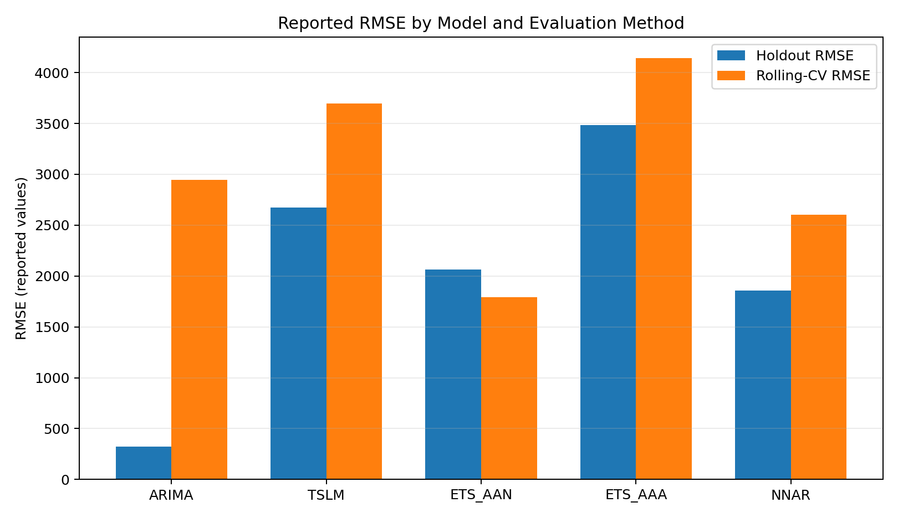

# Time-Series Analysis and Forecasting of COVID-19 Deaths in Italy

An academic team project exploring time-series forecasting of monthly COVID-19 deaths in Italy. The project compared statistical and neural-network forecasting methods and evaluated them using a holdout period and rolling-origin cross-validation.

> **Portfolio note:** This repository intentionally shares selected R code examples and a summary of results reported in the university report. It is not a complete reproduction of the team project, and the example code is not the team's original source code.

## Objective

Compare forecasting approaches and examine whether model performance remains consistent across different evaluation windows.

## Methods

- Time-series linear model (TSLM)
- ARIMA
- ETS(A,A,N) and ETS(A,A,A)
- Neural Network Autoregression (NNAR)
- Six-month holdout evaluation
- Rolling-origin cross-validation

## Reported Results

The values below are transcribed from the original team report. They are included as **reference results**, not as output generated by the selected example code in this repository.

| Model | Holdout RMSE | Holdout MAE | Rolling-CV RMSE | Rolling-CV MAE |
|---|---:|---:|---:|---:|
| ARIMA | 321 | 317 | 2,943 | 2,697 |
| TSLM | 2,672 | 2,114 | 3,695 | 3,310 |
| ETS(A,A,N) | 2,065 | 1,816 | 1,791 | 1,603 |
| ETS(A,A,A) | 3,486 | 3,307 | 4,141 | 3,537 |
| NNAR | 1,855 | 1,754 | 2,600 | 1,100 |

In the report's holdout comparison, ARIMA had the lowest RMSE. In rolling-origin cross-validation, ETS(A,A,N) had the lowest RMSE. This difference shows why model selection should consider more than one evaluation window or metric.

The report also noted that percentage-based errors can become very large when actual death counts are near zero, so MAPE should be interpreted cautiously for this dataset.

## Selected Code Example

`R/selected_code_examples.R` contains small illustrative R functions for calculating forecast metrics and creating rolling-origin splits. These examples demonstrate part of the evaluation workflow; they do not reproduce the full analysis or fit every model.

## Tools and Technologies

- **Language:** R
- **Time-series methods:** ARIMA, ETS, TSLM, NNAR
- **Evaluation:** RMSE, MAE, rolling-origin cross-validation
- **Data source described in the report:** Our World in Data COVID-19 dataset

## Academic Context

DS424 — Time Series and Forecasting for Data Science, Princess Nourah bint Abdulrahman University, First Semester 2025–2026.

This was a team academic project. The report identifies my assigned sections as **Model Specification** and **Performance Evaluation**.
